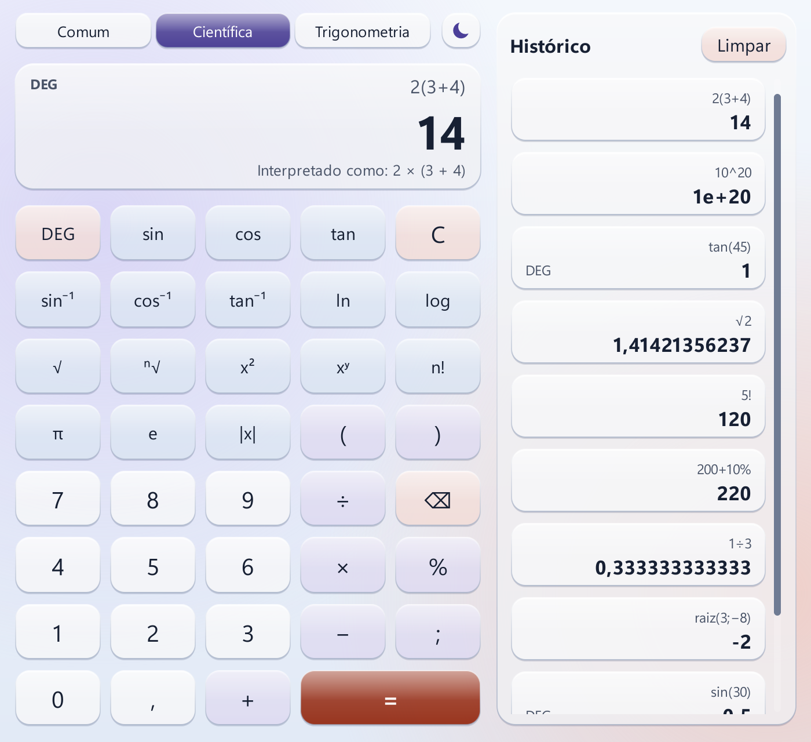
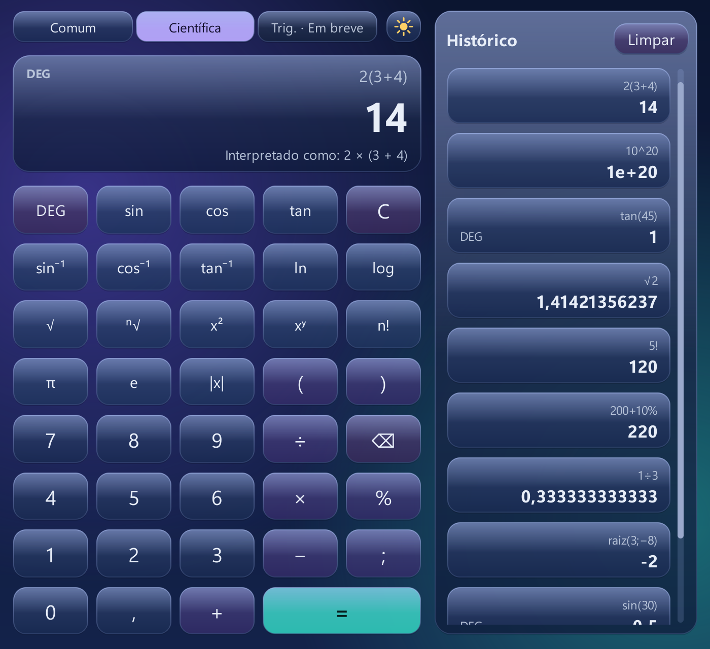
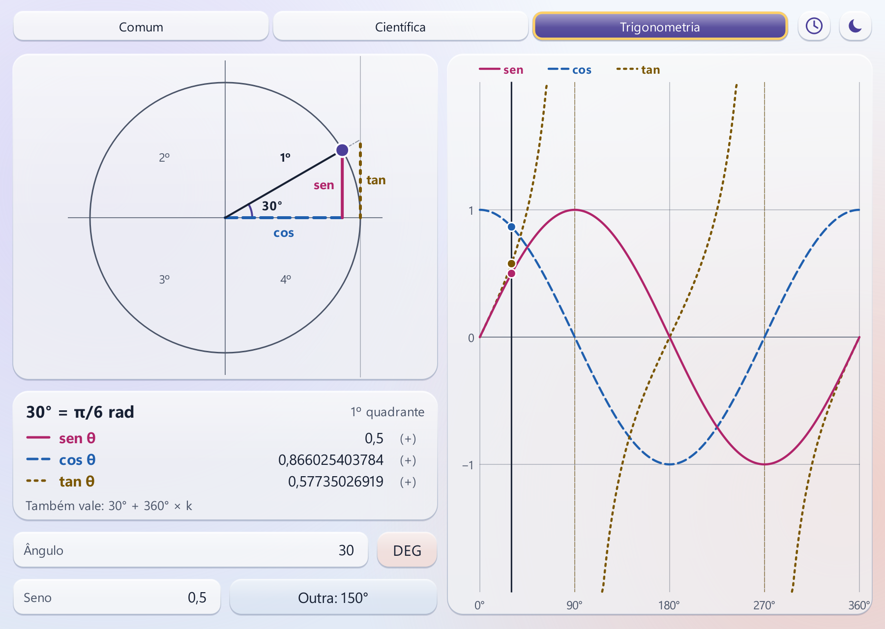
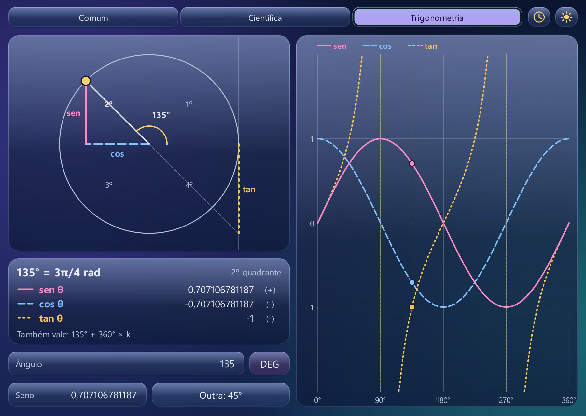
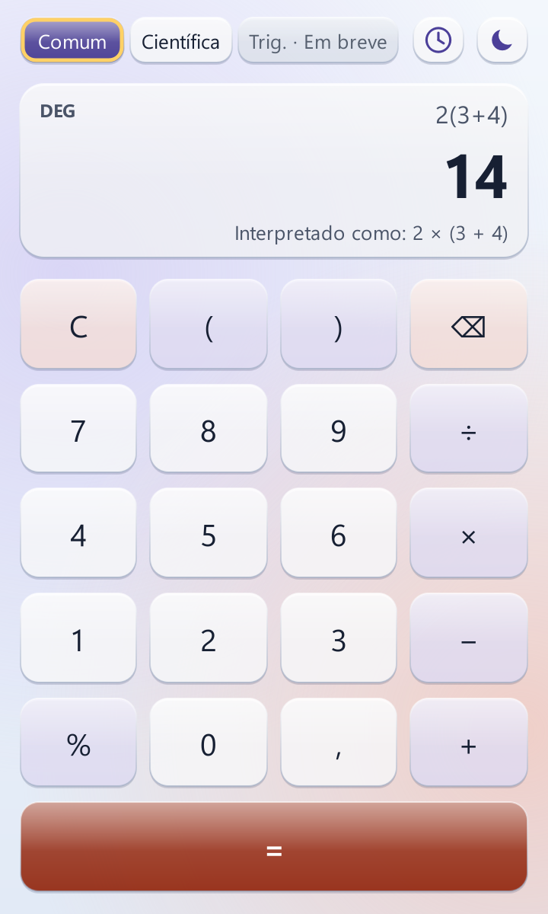
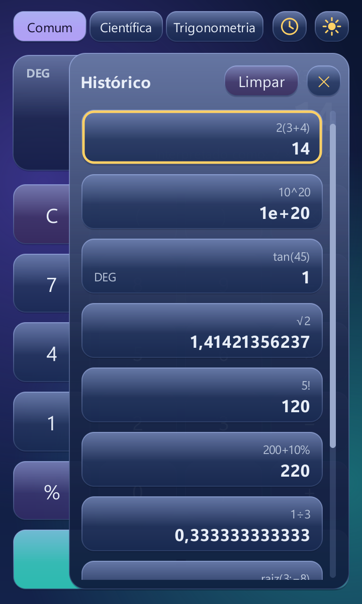

# AI Calc

Calculadora desktop em Python e PySide6, toda em português do Brasil, com visual de
"vidro líquido", tema claro e escuro, histórico das contas e um **círculo trigonométrico
interativo** com gráficos. O motor de cálculo é próprio: nada de `eval()`.

Projeto feito durante uma imersão da Alura em engenharia de software com IA, construído em
etapas pequenas, cada uma com testes automáticos.

<p align="center">
  
  
</p>

## O que ela faz

**Contas**
- Abas **Comum** e **Científica**: seno, cosseno, tangente e inversas, `ln`, `log`, `√`,
  raiz de índice n (`raiz(3; −8)` = −2), potência, fatorial, `π`, `e` e valor absoluto.
- Modo de ângulo **DEG/RAD**, com resultados exatos nos ângulos notáveis (`tan(45)` = 1,
  `tan(90)` é "Indefinida").
- Porcentagem como numa calculadora de mesa: `200 + 10%` = 220.
- Multiplicação implícita com aviso: `2(3+4)` mostra "Interpretado como: 2 × (3 + 4)".
- Números com vírgula decimal, até 12 dígitos significativos e notação científica (`1e+20`).
- Mensagens de erro em português ("Divisão por zero inválida", "Expressão incompleta"...).
  O app nunca fecha por causa de uma conta.
- Funciona pelo teclado físico: `12*3-6/2` e Enter.

**Trigonometria**
- Círculo trigonométrico interativo: arraste o ponto, clique no círculo ou use as setas
  (Shift anda de 15° em 15°). Perto de 30°, 45°, 60°… o ponto encaixa no ângulo notável.
- Seno, cosseno e tangente desenhados no círculo e nos gráficos de 0° a 360°, cada um com cor,
  rótulo e estilo de linha próprios (contínua, tracejada e pontilhada).
- Painel com o ângulo em graus e radianos (`135° = 3π/4 rad`), o quadrante, os valores com sinal
  e "Também vale: θ + 360° × k".
- Campos "Ângulo" (aceita contas como `450`, `-30` ou `π/6`) e "Seno": seno `0,5` leva a 30°, e o
  botão "Outra: 150°" mostra a outra solução (desativado em seno 1 ou −1, que só têm uma).
- Botões **sen**, **cos** e **tan** para mostrar ou esconder cada função (no círculo, nos gráficos
  e no painel); a escolha é lembrada.
- Janela larga: círculo e gráficos lado a lado. Janela estreita: seletor "Círculo | Gráficos".
- O ponto desliza até o novo ângulo; com "reduzir movimento", vai direto.

<p align="center">
  
  
</p>

**Visual**
- Teclas, visor, abas e painéis de vidro semitransparente com brilho e borda, sobre um fundo
  com manchas de cor.
- Tema claro (azul-gelo, lavanda e coral) e escuro (azul-marinho, roxo suave e turquesa), com
  transição de 450 ms. Um segundo clique no meio da transição a faz voltar do ponto em que
  estava.
- Abre seguindo o tema do Windows. Depois de escolhido no botão de lua/sol, vale o tema escolhido.
- Animações discretas de clique e de troca de aba. Com "reduzir movimento" ligado no Windows,
  tudo fica instantâneo.

**Histórico e preferências**
- As 20 últimas contas, com a mais nova em cima e a etiqueta DEG/RAD nas contas com trigonometria.
- Clicar num item insere só o número na conta atual (um número negativo entra entre parênteses).
- Painel fixo ao lado em janelas largas e gaveta com botão em janelas estreitas (mínimo de 360 px).
- "Limpar" pede confirmação numa janela de vidro.
- Tema, DEG/RAD e última aba são lembrados. Os arquivos são gravados de forma segura, e um
  arquivo corrompido é renomeado e o app recomeça vazio.

**Acessibilidade**
- Todas as teclas e itens têm nome para leitor de tela (ex.: "Multiplicar", "sin(30) igual a
  0,5, graus").
- Navegação por Tab com contorno de foco visível.
- Contraste de 4,5:1 para texto e de 3:1 para foco e ícones, verificado por testes nos dois
  temas e levando em conta a transparência do vidro.

<p align="center">
  
  &nbsp;
  
</p>

## Baixar

Para usar sem instalar nada: baixe o **`AI Calc.exe`** na página de
[Releases](https://github.com/Chiculol/AI-Calc/releases/latest) e abra com dois cliques
(Windows 10 ou 11).

> Na primeira vez, o Windows pode mostrar **"O Windows protegeu o computador"**, porque o
> executável não tem assinatura digital (ela é paga). Clique em **Mais informações** e depois em
> **Executar assim mesmo**.

O histórico e as preferências ficam em `%APPDATA%\AI Calc`.

## Como rodar a partir do código

Requisitos: Windows 10 ou 11 e Python 3.12 ou mais novo.

```bash
git clone https://github.com/Chiculol/AI-Calc.git
cd AI-Calc
python -m venv .venv
.venv\Scripts\activate
pip install -r requirements.txt
python -m ai_calc
```

> **Dica:** no Windows, o PySide6 não carrega se o caminho da pasta do projeto for muito longo.
> Se aparecer o erro `DLL load failed ... nome do arquivo ou a extensão é muito grande`, clone
> o projeto numa pasta de caminho curto (por exemplo, `C:\Projetos\AI-Calc`).

### Gerar o executável

```bash
pip install -r requirements-build.txt
python tools/gerar_executavel.py
```

O `AI Calc.exe` (um arquivo só, cerca de 45 MB) aparece em `dist/`. O ícone vem de
`assets/ai_calc.ico`, que `tools/gerar_icone.py` desenha a partir do código do app.

## Testes

```bash
pytest
```

São 576 testes. Eles cobrem o motor de cálculo, o círculo trigonométrico, o histórico e as
preferências, além da janela (com [pytest-qt](https://pytest-qt.readthedocs.io/), em modo
offscreen, sem abrir nada na tela). Os testes de janela clicam nas teclas, usam o teclado,
arrastam o ponto do círculo, trocam o tema no meio da transição e conferem as cores de cada
elemento.

Para conferir à mão, veja a [lista de conferência](docs/LISTA_DE_CONFERENCIA.md), que inclui
como simular um arquivo corrompido e o "reduzir movimento".

## Como o código está organizado

```
ai_calc/
├── core/          motor sem interface (testado sozinho)
│   ├── tokenizer.py, parser.py, evaluator.py   leitura e cálculo das contas
│   ├── calculator.py, formatting.py, errors.py resultado, formatação pt-BR e erros
│   ├── editor.py                                o que cada tecla faz
│   ├── trig.py, trig_input.py                   funções, círculo, gráficos e campos da trigonometria
│   └── history.py, preferences.py, storage.py   histórico, preferências e gravação segura
└── ui/            interface PySide6
    ├── main_window.py, app.py                   janela e inicialização
    ├── theme.py, system.py                      paletas, transição e "reduzir movimento"
    ├── glass.py, glass_button.py, tabs.py       desenho do vidro, teclas e abas
    ├── trig_page.py, trig_circle.py, trig_graphs.py   aba Trigonometria
    └── display.py, keypad.py, glass_field.py, history_panel.py, confirm_dialog.py
```

As decisões de comportamento (porcentagem, fatorial, erros, precedência...) estão em
[docs/ESPECIFICACAO.md](docs/ESPECIFICACAO.md).

## Andamento

| Etapa | Conteúdo | Status |
|---|---|---|
| 1 | Motor de cálculo e testes | ✅ |
| 2 | Lógica do círculo trigonométrico | ✅ |
| 3 | Interface Comum e Científica, tema claro/escuro, vidro, histórico e preferências | ✅ |
| 4 | Aba Trigonometria: círculo interativo e gráficos | ✅ |
| 5 | Acabamento: mostrar/esconder cada função, transições, ícone e executável | ✅ |

## Licença

[MIT](LICENSE): pode usar, copiar e modificar, mantendo o aviso de autoria.
